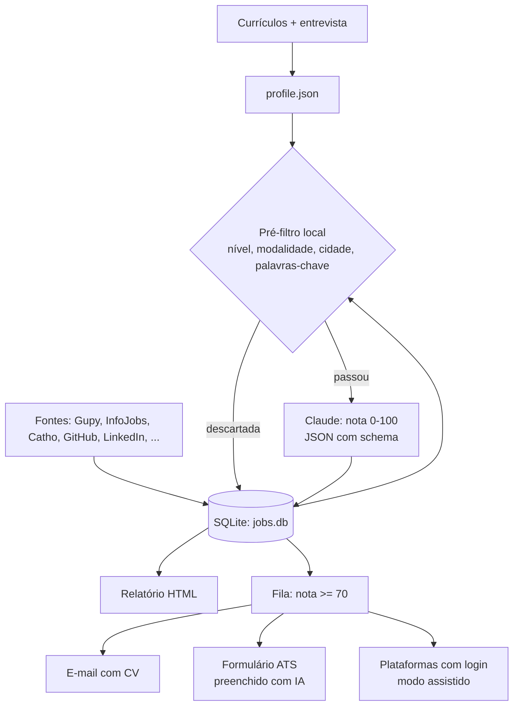

# Job Finder

**Busca vagas de TI em mais de 10 sites brasileiros, dá uma nota de aderência a cada uma com IA
(Claude) e ajuda a se candidatar, sem inventar dados e respeitando os termos de cada plataforma.**


> English summary at the [end of this page](#english-summary).

## O problema

Procurar emprego como desenvolvedor júnior é um trabalho repetitivo:
- as vagas estão espalhadas em dezenas de sites;
- muitas são sênior com título de júnior, ou presenciais em outra cidade;
- cada candidatura pede o mesmo formulário de novo.

Este projeto automatiza a parte mecânica (achar, filtrar, ranquear e preparar) e deixa para a
pessoa só as decisões.

Uso o Job Finder na minha própria busca de emprego. No primeiro mês:

| Vagas coletadas | Analisadas pela IA | Candidaturas |
|---:|---:|---:|
| ~7.300 | ~2.700 | ~180 |

## O que ele faz

- **Entende o candidato.** Lê os currículos (PDF/DOCX) e faz uma entrevista curta no terminal:
  pretensão, modalidade, cidades, CLT/PJ e o que a pessoa não aceita. O resultado é um `profile.json`.
- **Busca em várias fontes:**
  - Gupy, Remotar, InfoJobs, Catho, Vagas.com, Sólides, Recrutei, ProgramaThor
  - LinkedIn (busca pública)
  - repositórios de vagas da comunidade no GitHub (backend-br, frontendbr, soujava...)
  - boards de Greenhouse e Lever
  - busca na web
- **Filtra antes de gastar IA.** Um pré-filtro local descarta vaga de nível acima, de modalidade
  ou cidade não aceita e sem nenhuma palavra-chave do perfil.
- **Dá nota com o Claude.** Cada vaga que passa no filtro recebe, em JSON validado por schema:
  - nota de 0 a 100 e veredito;
  - skills que batem e skills que faltam;
  - regime e salário;
  - red flags;
  - o melhor canal de candidatura.
- **Gera um relatório HTML** com filtros por modalidade, nota e status.
- **Prepara e envia candidaturas.** Carta, e-mail e pitch são gerados só com fatos do perfil. O
  envio pode ser:
  - por e-mail;
  - em formulário de ATS, preenchido com IA;
  - assistido, abrindo a vaga para a pessoa enviar.

## Como funciona



## Decisões de projeto

- **IA só onde agrega.** O pré-filtro em Python puro elimina a maior parte das vagas sem custo. O
  modelo só analisa o que tem chance real, e uma vaga já vista nunca é analisada de novo.
- **Saída estruturada.** Toda chamada ao Claude devolve JSON validado por JSON Schema
  (`output_config.format` na API, `--json-schema` no Claude Code). O resto do código trabalha
  com dados estruturados, não com texto livre.
- **Dois backends de IA com a mesma interface.**
  - Com `ANTHROPIC_API_KEY`, usa a API, paga por uso.
  - Sem chave, usa o Claude Code logado na assinatura (`claude -p`).
  - Tenta de novo quando várias chamadas paralelas colidem na renovação do login.
- **Deduplicação entre fontes.** A mesma vaga aparece no LinkedIn, no Indeed e na Gupy. O banco
  normaliza o link e compara título + empresa para não analisar nem se candidatar duas vezes.
- **Automação com limites.**
  - O envio automático só acontece em domínios de ATS permitidos (Greenhouse, Lever, Ashby,
    Workable) e sem captcha.
  - Em sites cujos termos proíbem automação (LinkedIn, Gupy, Indeed, Catho...), o modo é sempre
    assistido: a pessoa clica em enviar.
- **A IA não inventa dados.** CPF, data de nascimento, aceite de termos e perguntas pessoais
  ficam com a pessoa, e os materiais usam só fatos do perfil.
- **Coleta educada.** Fontes com histórico de bloqueio têm atraso entre requisições e limite de
  páginas de detalhe por rodada.

## Stack

Python 3.11 · SQLite · httpx · Playwright · pypdf / python-docx · Rich · Anthropic SDK / Claude Code

```
jobfinder/
├── cli.py            comandos (setup, search, import, list, report, apply, run)
├── profile.py        leitura do CV + entrevista -> profile.json
├── sources/          um módulo por site (gupy.py, catho.py, infojobs.py, github_issues.py, ...)
├── matcher.py        pré-filtro + análise com o Claude
├── llm.py            camada fina sobre API / Claude Code com JSON Schema
├── db.py             SQLite, deduplicação e status das vagas
├── importer.py       importação de vagas por arquivo ou área de transferência
├── report.py         relatório HTML
└── apply/            materiais, e-mail, preenchimento de formulário com Playwright
```

## Como usar

1. Instale as dependências:
   ```bash
   pip install -r requirements.txt
   ```
   ```bash
   python -m playwright install chromium
   ```
2. Configure o acesso ao Claude, de um destes dois jeitos:
   - **Assinatura:** instale o [Claude Code](https://claude.com/claude-code) e rode `claude auth login`.
   - **API:** copie `.env.example` para `.env` e preencha `ANTHROPIC_API_KEY`.
3. Coloque seus currículos em `data/cv/` e liste-os em `config.yaml` → `cvs`, um por área e idioma.
4. Rode os comandos:

| Comando | O que faz |
|---|---|
| `python -m jobfinder setup` | Lê os currículos, faz a entrevista e cria `data/profile.json` (formato em `data/profile.example.json`) |
| `python -m jobfinder search --no-web` | Busca vagas novas, filtra e dá nota |
| `python -m jobfinder import --file vagas.jsonl --score` | Importa vagas de um arquivo (uma vaga JSON por linha) e dá nota |
| `python -m jobfinder report --open` | Abre o relatório em `output/relatorio.html` |
| `python -m jobfinder list --min 70` | Lista as melhores vagas no terminal |
| `python -m jobfinder apply --mode assisted` | Candidata-se às vagas da fila; você confirma cada envio (`--dry-run` só simula) |
| `python -m jobfinder run` | `search` + `report` + `apply`, para agendar no Windows ou no cron |

No Windows, `JobFinder.bat` abre um menu com essas opções.

### Configuração (`config.yaml`)

- `model`: modelo do Claude. `claude-haiku-5-5` basta para dar nota e custa bem menos.
- `search.sources.*`: liga ou desliga cada fonte e define os termos de busca.
- `matching.min_score_apply`: nota mínima para entrar na fila (padrão 70).
- `apply.auto_submit_domains` / `assisted_only_domains`: onde o envio automático é permitido.

## Limites

- Os sites mudam o HTML com frequência, e um módulo de `sources/` pode quebrar até ser ajustado.
- A nota é uma estimativa de aderência, não uma garantia. O relatório mostra o motivo de cada nota
  para a pessoa decidir.
- O projeto não contorna captcha, login nem bloqueio de nenhum site.

---

## English summary

**Job Finder** is a Python CLI that searches 10+ Brazilian job boards for tech jobs, scores each
one against the candidate's profile with Claude, and helps with applications. In its first month of
real use: ~7,300 jobs collected, ~2,700 scored by the LLM, ~180 applications.

- **Profile:** built from resumes (PDF/DOCX) plus a short interview.
- **Sources:** Gupy, InfoJobs, Catho, Vagas.com, Sólides, Recrutei, ProgramaThor, public LinkedIn,
  community job repos on GitHub, Greenhouse/Lever boards and the web.
- **Pre-filter:** a free local filter (seniority, work model, city, keywords) runs before any LLM call.
- **Scoring:** Claude returns a 0–100 fit score as JSON validated against a schema. It includes
  matched and missing skills, contract type, red flags and the best application channel.
- **LLM backends:** two interchangeable ones, the Anthropic API or Claude Code (`claude -p`) on a
  subscription.
- **Data:** cross-source deduplication in SQLite, an HTML report, and application materials
  generated only from real profile facts.
- **Limits:** auto-submission only on allowed ATS domains without captcha. Platforms whose terms
  forbid automation always run in assisted mode.

Stack: Python 3.11, SQLite, httpx, Playwright, Anthropic SDK / Claude Code.

## Autor

**Rafael Bertochi**, estudante de Análise e Desenvolvimento de Sistemas, com foco em back-end e dados.

[GitHub](https://github.com/rafaelbertochi1) · [Portfólio](https://rafaelbertochi1.github.io) · [LinkedIn](https://www.linkedin.com/in/rafael-bertochi1)
